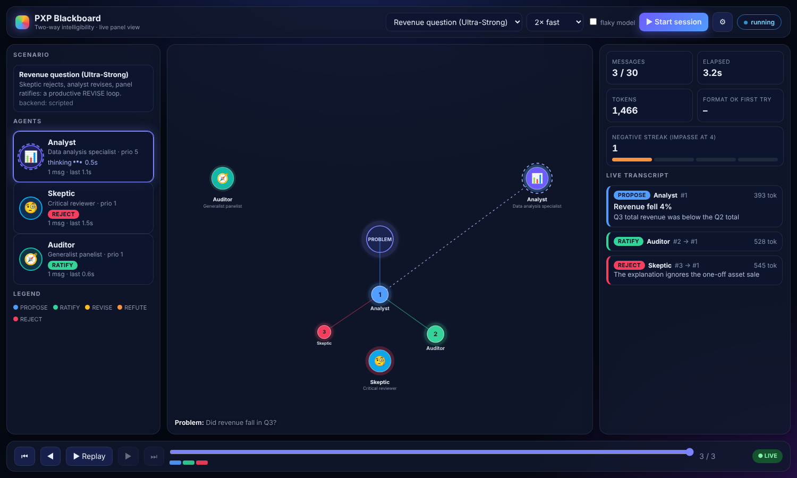
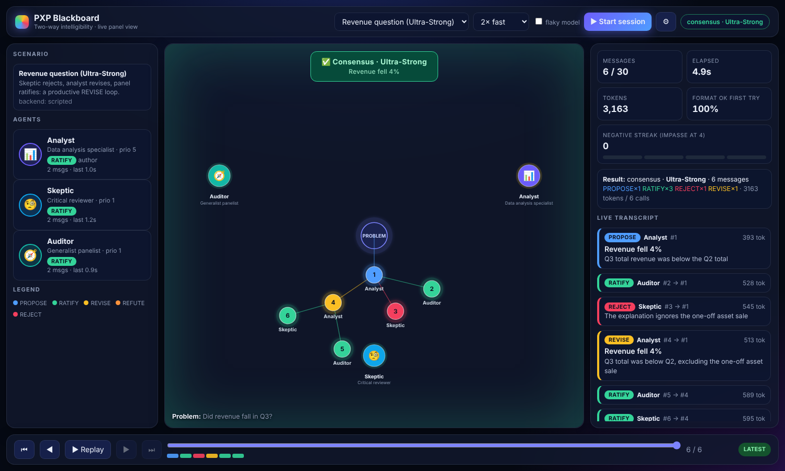
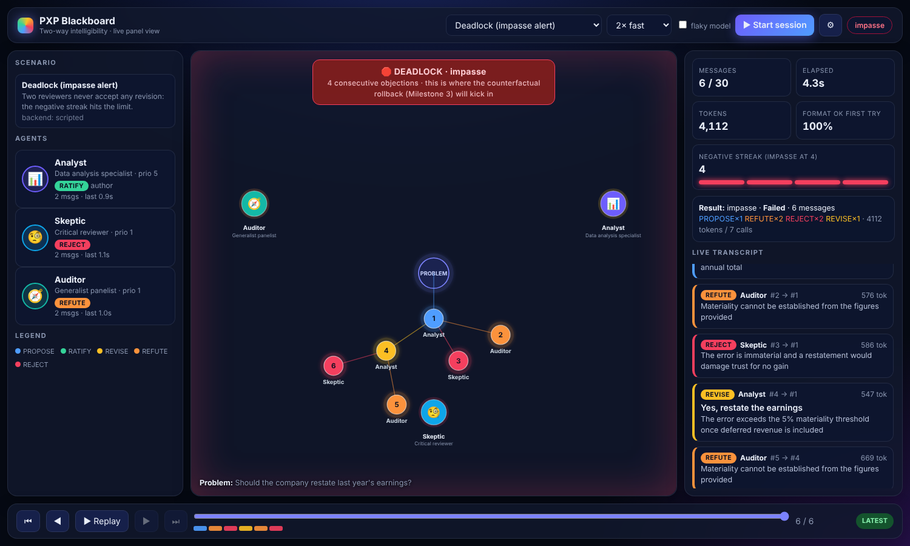
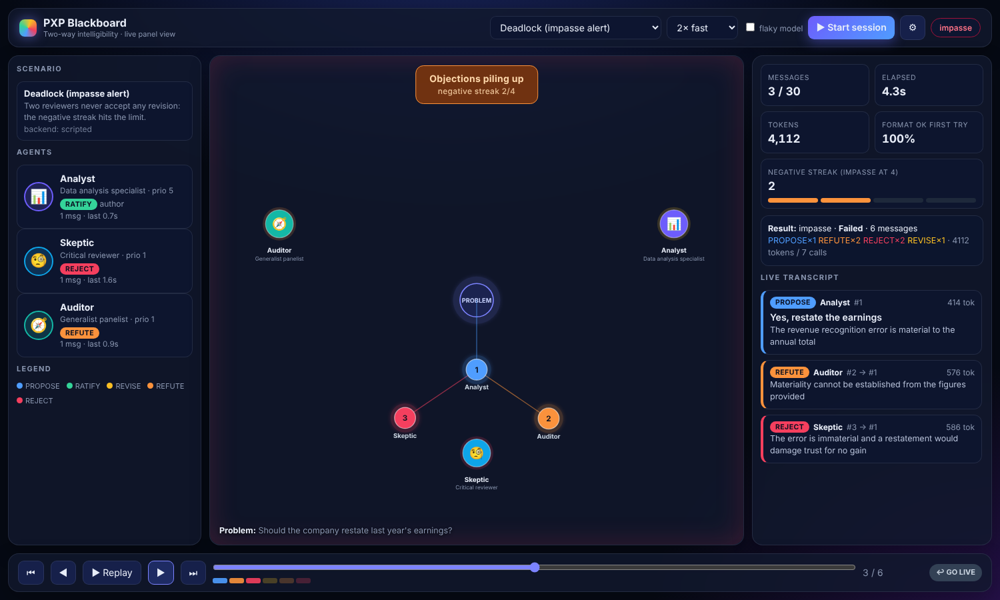

# PXP Blackboard — Intelligible Blackboard Architecture with Counterfactual Agents

**Team Epsilon · Reasoning Agents project.** Status as of this package: **Milestone 1 ✅ · Milestone 2 ✅ · live demo dashboard ✅ · Milestone 3 (counterfactual agents) ✅ · Milestone 4 ablation ✅ on simulated panels (real-dataset runs ⏳, see §12).**

> **New in this version (Milestones 3–4):** `pxp_blackboard/counterfactual.py` (sandbox), scheduler hook, a *Counterfactual rescue* dashboard scenario with a sandbox panel, `pxp_blackboard/sim.py` (simulated PEX agents), `scripts/ablation.py`, `scripts/summarize.py`, `scripts/plots.py`, results in `results/`, and 9 new tests (55 total). Jump to [§0](#0-milestones-3-and-4-quick-reproduction).

## 0. Milestones 3 and 4: quick reproduction

```bash
python -m pytest -q                       # 55 passed
python scripts/serve.py                   # pick "Counterfactual rescue (Milestone 3)" in the dashboard
python scripts/ablation.py                # 500 paired trials x 5 configs -> results/ablation.csv (~15 s)
for f in 0.4 0.6 1.0; do python scripts/ablation.py --configs cf100,cf33 --fidelity $f --out results/fidelity_$f.csv; done
python scripts/summarize.py results/ablation.csv   # table with 95% bootstrap CIs
python scripts/plots.py                   # results/fig_ablation.pdf + results/stats.txt (paired sign tests)
```

**How the counterfactual sandbox works** (`counterfactual.py`): when the live board deadlocks (negative streak ≥ impasse threshold, or 3 REVISEs without consensus), the scheduler drains in-flight calls and lets each counterfactual agent (flag `counterfactual=True`, one reflection per session by default) (1) take its 2 most recent messages as rollback points, (2) rebuild an isolated board from the log before each point, (3) ask for ≤4 alternative messages (`propose_alternatives`; for LLM agents a dedicated prompt listing every objection), (4) roll forward ≤8 messages with sandbox copies of all agents, (5) score each timeline `S = 10·[consensus] − (1−[consensus])·distance − 0.5·tokens/1000 − belief_cost`, and (6) post the best alternative on the live board as a legal REVISE/RATIFY if it beats the current board. Every other agent then gets one more answer before an impasse is declared. Events `counterfactual_started` / `counterfactual_finished` stream to the dashboard.

**Ablation results (500 paired trials, simulated 3-agent panels):**

| Config | Converged | Accurate | Ultra-Strong | Impasse | tokens/trial |
|---|---|---|---|---|---|
| control (0% CF) | 50.6 | 47.0 | 43.0 | 29.2 | 7.6k |
| control+ (θ=8) | 50.6 | 47.0 | 43.0 | 29.2 | 9.5k |
| 33% CF | 72.0 | 65.4 | 64.4 | 19.8 | 17.1k |
| 66% CF | 80.4 | 73.0 | 72.8 | 14.6 | 23.5k |
| 100% CF | 87.2 | 78.2 | 79.6 | 11.2 | 27.7k |

**Important:** these use *simulated* agents (`sim.py`) that speak the real protocol through the real board, scheduler and sandbox; only the LLM is replaced. To run the same study with a real model, give the ablation runner LLM agents (`LLMAgent(..., counterfactual=True)`) and a dataset loader; at ~1 min/session budget for a 50-trial pilot first.


This README is written so someone who has never seen the project can (1) run it in five minutes, (2) understand how every part works and why it was built that way, and (3) know exactly what to build next.

---

## Contents
1. [What this project is](#1-what-this-project-is)
2. [Status at a glance](#2-status-at-a-glance)
3. [What's in this package](#3-whats-in-this-package)
4. [Quick start (5 minutes)](#4-quick-start-5-minutes)
5. [Walkthrough: the live dashboard](#5-walkthrough-the-live-dashboard)
6. [Running with a real local 7B model (Ollama)](#6-running-with-a-real-local-7b-model-ollama)
7. [The life of one session, step by step](#7-the-life-of-one-session-step-by-step)
8. [How it was built (architecture and design decisions)](#8-how-it-was-built-architecture-and-design-decisions)
9. [API reference](#9-api-reference)
10. [Tests](#10-tests)
11. [Simplifications and known limitations](#11-simplifications-and-known-limitations)
12. [Future requirements (Milestones 3 and 4)](#12-future-requirements-milestones-3-and-4)
13. [What to do now (prioritised checklist)](#13-what-to-do-now-prioritised-checklist)
14. [Team roles](#14-team-roles)
15. [FAQ](#15-faq)
16. [Troubleshooting](#16-troubleshooting)

---

## 1. What this project is

Most multi-agent LLM systems pass text from one agent to the next in a chain. Over long tasks that chain degrades like a game of telephone. A **blackboard architecture** fixes this: every agent reads from and writes to **one shared, structured state** (the blackboard) and reacts to changes on it.

We add two ideas on top:

- **PXP, the Two-Way Intelligibility Protocol** (Baskar et al., as cited in our proposal). Agents are *PEX agents*: each message carries a **prediction** ("what") and an **explanation** ("why"), plus a strict **tag** that says how the agent relates to the current hypothesis: `RATIFY`, `REVISE`, `REFUTE` or `REJECT`. From the stream of tags, the controller classifies a session as **Strong** or **Ultra-Strong** intelligibility (or Failed).
- **Counterfactual agents** *(Milestone 3, still to build)*. When the board deadlocks, selected agents replay the history in a private sandbox and ask: *"If I had said something different earlier, would we be closer to consensus now?"* They use the answer to break the deadlock.

The full plan is in `docs/Project_Proposal.pdf`, and our progress presentation is `docs/Presentation_Epsilon.pptx`.

---

## 2. Status at a glance

| Area | Status | Where |
|---|---|---|
| Thread-safe blackboard (shared state, history, versions, JSON persistence) | ✅ Done, tested | `pxp_blackboard/blackboard.py` |
| PXP tag validator and state-transition rules | ✅ Done, tested | `validator.py`, `models.py` |
| Event-driven scheduler (priority, concurrency, consensus/impasse, limits, faulty agents) | ✅ Done, tested | `scheduler.py` |
| Local LLM backends (Ollama/vLLM/llama.cpp via OpenAI-compatible API; HF in-process) | ✅ Done; HTTP path tested against a fake server | `llm/backends.py` |
| Prompt library (8 persona JSON files) and structured prediction + explanation output | ✅ Done, tested | `prompt_library/`, `prompts.py` |
| Self-repairing output parser (bad JSON gets fixed by re-asking, up to 3 tries) | ✅ Done, tested | `parsing.py`, `llm_agent.py` |
| Token and format-compliance accounting | ✅ Done, tested | `ledger.py` |
| FastAPI + WebSocket streaming backend | ✅ Done, tested | `server/` |
| Live dashboard (animated graph, transcript, meters, deadlock alert, scrubber/replay) | ✅ Done, tested in Chromium with scripted agents | `server/static/index.html` |
| Counterfactual rollback sandbox + scheduler hook | ✅ Done, tested | `counterfactual.py`, `scheduler.py` |
| Counterfactual sandbox panel in UI | ✅ Done (shows alternative timelines) | `index.html`, scenario *Counterfactual rescue* |
| Simulated PEX agents for the ablation | ✅ Done, tested | `sim.py` |
| Ablation runner (0/33/66/100 % CF + control+), stats, plots | ✅ Done, 500 trials/config | `scripts/ablation.py`, `summarize.py`, `plots.py`, `results/` |
| Dataset ingestors (KramaBench, MSCoRe, MedAgentBench) | ⏳ Not done (see report §6) | — |

**Honest notes:** the dashboard has been verified end to end with the scripted demo agents. The real-model path (Qwen 2.5 7B via Ollama) has been run from the command line by the team, but driving it from the dashboard's ⚙ menu has not been tried yet. That is the first item in §13.

---

## 3. What's in this package

```
pxp_blackboard/
├── README.md                    ← you are here
├── requirements.txt             ← Python dependencies
├── start_dashboard.bat          ← one-click start (Windows)
├── start_dashboard.sh           ← one-click start (macOS/Linux)
├── demo.py                      ← Milestone 1 demo: pure scheduler, no LLM, prints a session
├── scripts/
│   ├── run_session.py           ← Milestone 2 CLI: run a session (scripted or real model)
│   └── serve.py                 ← start the web dashboard (port 8000, or $PORT)
├── pxp_blackboard/              ← the library
│   ├── models.py                ← Tag enum, Draft (proposed move), Message (posted move)
│   ├── validator.py             ← PXP rules: is this move legal right now?
│   ├── blackboard.py            ← the shared state store (thread-safe, append-only log)
│   ├── scheduler.py             ← who acts next, concurrency, consensus/impasse, results
│   ├── agents.py                ← Agent interface + ScriptedAgent (for tests/demos)
│   ├── prompts.py               ← PromptLibrary, legal-move calculation, prompt builder
│   ├── parsing.py               ← turn raw model text into a validated Draft
│   ├── llm_agent.py             ← LLMAgent: prompt → model → parse → repair loop
│   ├── ledger.py                ← tokens per agent/call + format-compliance stats
│   ├── prompt_library/*.json    ← personas: data_analyst, skeptic, generalist, clinician,
│   │                               pharmacologist, energy_analyst, automotive_engineer, synthesizer
│   ├── llm/
│   │   ├── backends.py          ← MockBackend, OpenAICompatBackend, HFBackend
│   │   └── mock.py              ← scripted "models" + the 4 demo scenarios
│   └── server/
│       ├── app.py               ← FastAPI routes + WebSocket endpoint
│       ├── sessions.py          ← one Session = board + agents + scheduler on a thread
│       ├── hub.py               ← event fan-out to WebSocket clients, full replay
│       └── static/index.html    ← the dashboard (vanilla JS + SVG, single file)
├── tests/                       ← 46 pytest tests (see §10)
└── docs/
    ├── Project_Proposal.pdf
    ├── Presentation_Epsilon.pptx
    └── screenshots/             ← dashboard screenshots used in this README
```

---

## 4. Quick start (5 minutes)

### Requirements
- **Python 3.10 or newer** (developed and tested on 3.12). Check with `python --version` (`python3 --version` on macOS/Linux).
- A modern browser (Chrome, Edge, Firefox).
- *Optional:* [Ollama](https://ollama.com) if you want a real local model (§6).

### Option A: one click
- **Windows:** double-click `start_dashboard.bat`.
- **macOS/Linux:** run `./start_dashboard.sh` in a terminal.

The first run creates a virtual environment in `.venv` and installs the dependencies (this needs internet once). It then starts the server and opens http://127.0.0.1:8000. Go to §5.

### Option B: step by step

**Step 1. Unzip and enter the folder**
```bash
cd pxp_blackboard
```

**Step 2. Create and activate a virtual environment** (keeps dependencies separate from your system Python)
```bash
# Windows (PowerShell)
python -m venv .venv
.venv\Scripts\Activate.ps1
# macOS / Linux
python3 -m venv .venv
source .venv/bin/activate
```

**Step 3. Install the dependencies**
```bash
pip install -r requirements.txt
```

**Step 4. Run the tests** (they should print `46 passed`)
```bash
python -m pytest -q
```

**Step 5. Milestone 1 demo** (the scheduler and board alone, with no LLM)
```bash
python demo.py
```
Expected: six numbered messages (PROPOSE, RATIFY, REJECT, REVISE, RATIFY, RATIFY) and a result line containing `'outcome': 'consensus'` and `'intelligibility': 'Ultra-Strong'`.

**Step 6. Milestone 2 demo** (the full LLM-agent pipeline, using scripted models so no GPU is needed)
```bash
python scripts/run_session.py            # clean run
python scripts/run_session.py --flaky    # models emit broken JSON; watch the repair loop fix it
python scripts/run_session.py --save board.json   # also save the final board to JSON
```

**Step 7. The live dashboard**
```bash
python scripts/serve.py
```
Open **http://127.0.0.1:8000**. Stop the server with **Ctrl+C**.

---

## 5. Walkthrough: the live dashboard



**Step 1. Pick a scenario** (top bar). Each one is a short scripted story.

| Scenario | What happens | Expected result |
|---|---|---|
| Easy consensus | Analyst proposes, everyone ratifies straight away | Consensus · **Strong** |
| Revenue question | Skeptic rejects, Analyst revises, everyone ratifies | Consensus · **Ultra-Strong** |
| Clinical diagnosis | Skeptic rejects and Pharmacist refutes; Clinician adds ECG/troponin evidence; ratified | Consensus · **Ultra-Strong** |
| Deadlock | Two reviewers reject every revision; the negative streak hits 4 | **Impasse** (red alert) |

**Step 2. Pick a speed.** At 1× each scripted agent "thinks" for about 1.5–2.5 seconds (randomly jittered), so the session plays out like a real one. Use 0.5× when presenting and 5× for a quick check.

**Step 3. Optional: tick "flaky model".** Roughly every other first attempt is then malformed (chatty text, an illegal tag, or truncated JSON). Watch the 🔧 "2 tries" badges and the "repaired" counters: the repair loop catches every error and the session still ends the same way.

**Step 4. Press ▶ Start session** and watch:
- **Agents** (left panel and on the stage): a spinning dashed ring, a beam to the board and a live "thinking 1.4s" timer while an agent waits on its model.
- **The graph** (centre): the **PROBLEM** node is the root. When an agent posts, a particle flies from the agent to the message it answers, and the new node glides out of that message. Colours follow the legend (PROPOSE blue, RATIFY green, REVISE amber, REFUTE orange, REJECT red). Hover a node for its full text; click it to highlight it in the transcript.
- **Meters** (right): messages used against the limit, elapsed time, tokens, first-try format success, and the **negative streak** against the impasse threshold.
- **Alerts:** an orange edge glow when objections pile up, a red "deadlock imminent" banner one step before the limit, then a red **DEADLOCK** banner at impasse. A green banner shows consensus and its intelligibility level.




**Step 5. Review the history with the scrubber** (bottom bar). ⏮ ◀ ▶ ⏭ step through messages, the slider jumps anywhere, and **▶ Replay** animates the session again. The keyboard works too: ← → step, Space plays or pauses. The coloured ticks under the slider are the message tags. **GO LIVE** returns to the latest state.



**Handy links:**
- `http://127.0.0.1:8000/?scenario=deadlock&speed=0.5&autostart=1` starts a chosen scenario immediately.
- Opening `pxp_blackboard/server/static/index.html` straight from disk also works while the server runs. Point it at another server with `?server=http://host:port`.

**The ⚙ button** opens advanced settings: model source (scripted or **local model**), base URL, model name, an optional custom problem, and the server address.

---

## 6. Running with a real local 7B model (Ollama)

**Step 1.** Install Ollama from https://ollama.com and pull the model:
```bash
ollama pull qwen2.5:7b
```
Ollama runs in the background and serves an OpenAI-compatible API at `http://localhost:11434/v1`. A 7B model needs about 5 GB of free RAM or VRAM; a GPU makes it much faster.

**Step 2. Command line:**
```bash
python scripts/run_session.py --backend openai --base-url http://localhost:11434/v1 --model qwen2.5:7b
```
With a custom problem and panel (agents are written as `id:persona[:priority]`):
```bash
python scripts/run_session.py --backend openai --base-url http://localhost:11434/v1 --model qwen2.5:7b \
  --problem "A 54-year-old has chest pain radiating to the left arm. Most likely diagnosis?" \
  --agents "Doc:clinician:5,Critic:skeptic,Pharm:pharmacologist"
```
On Windows PowerShell, replace the trailing `\` with a backtick `` ` ``, or put everything on one line.

**Step 3. Dashboard:** run `python scripts/serve.py`, click **⚙**, set *model source* to **Local model (OpenAI-compatible)**, base URL to `http://localhost:11434/v1` and model to `qwen2.5:7b`. Pick a scenario (it supplies the problem and agents, or type your own problem) and press Start.

**What to expect:** real runs are slow (the team's CLI run took about 54 s of model time and about 10k tokens), and a 7B model often argues itself into an **impasse**. That is the behaviour Milestone 3 is designed to fix.

**Other servers:** vLLM (`vllm serve Qwen/Qwen2.5-7B-Instruct`) also listens on port 8000, so run the dashboard on another port: `PORT=8001 python scripts/serve.py` (PowerShell: `$env:PORT=8001; python scripts/serve.py`). `HFBackend` (in-process `transformers`) exists but is untested; install the commented-out packages in `requirements.txt` to use it.

---

## 7. The life of one session, step by step

Using the "Revenue question" scenario as the example:

1. **Setup.** `Session` creates a `Blackboard` with the problem and the registered agents (Analyst priority 5, Skeptic 1, Auditor 1), wraps each persona in an `LLMAgent`, and starts a `Scheduler` on a background thread. The server emits `session_started`.
2. **Who acts?** The scheduler scores every agent with `default_policy`. The board is empty, so everyone is eligible, and the highest priority (Analyst) goes first. At most `max_concurrent` (2) agents run at once.
3. **The agent decides.** `LLMAgent.act()` receives a **snapshot** of the board and asks `allowed_tags()` for the legal moves (empty board: only `PROPOSE`). It builds a prompt from the persona, a PXP primer, the board text, the legal tags and a JSON schema, then calls the model.
4. **Parse and repair.** `parse_response()` extracts JSON leniently (code fences and chatter are tolerated) and checks it with the **same validator the board uses**. If it is invalid, the exact error is sent back to the model and it retries (up to 3 attempts). Still invalid means the agent passes on this board version; nothing crashes.
5. **Post.** The board's `post()` takes a lock, re-validates (another agent may have moved the head meanwhile; such stale writes are rejected), appends the message, updates the head, stances and negative streak, and notifies subscribers. The server emits `message` with the new stances and streak.
6. **React.** The new message wakes the scheduler. Skeptic and Auditor haven't seen the new head, so both become eligible. Auditor posts `RATIFY` and Skeptic posts `REJECT` ("ignores the one-off asset sale").
7. **Revise.** The author is only eligible when there are unanswered objections, and then it gets a priority boost. The Analyst posts `REVISE` with a changed explanation, which becomes the new head. Everyone else's stance resets because they haven't seen it yet.
8. **Converge.** Both reviewers `RATIFY` the revision. Every non-author's latest stance is RATIFY, so we have **consensus**. A REVISE followed a REJECT, so it is **Ultra-Strong**.
9. **Finish.** The scheduler returns a `RunResult` (outcome, iterations, tag counts, intelligibility, final prediction, protocol errors). The server emits `session_finished` with the result, token totals and format stats.

The other stopping rules are: **impasse** (`impasse_threshold` = 4 REFUTE/REJECTs in a row, where only a RATIFY resets the streak), **max messages** (default 30), and **no eligible agents**. An agent that breaks protocol `max_protocol_errors` (3) times is **benched**, not fatal.

---

## 8. How it was built (architecture and design decisions)

The proposal describes four layers. Here is how each one is implemented and why.

### A. Communication layer: the PXP-governed board (`models.py`, `validator.py`, `blackboard.py`)

**Tags and rules** (a simplified PXP):

| Tag | Meaning | Needs | Who / when |
|---|---|---|---|
| `PROPOSE` *(our addition)* | Open the board with a first hypothesis | prediction + explanation | Only when the board is empty |
| `RATIFY` | Agree with the current prediction and explanation | nothing (content is stripped) | Not the head's author |
| `REVISE` | Write an adjusted thesis | a *changed* prediction/explanation | The author, or anyone |
| `REFUTE` | "I can't accept this, but I can't correct it either" (a logical roadblock) | explanation of the roadblock | Not the author |
| `REJECT` | Fundamentally conflicts with the hypothesis | explanation (counter-prediction optional) | Not the author |

**Design decisions:**
- **Append-only log plus a derived head.** History is never edited, so the full trace is always available. The dashboard, the scrubber and the future counterfactual replay all depend on that.
- **Optimistic concurrency.** Every response must target the *current* head. If two agents race, the second write is rejected as stale instead of silently answering an outdated hypothesis.
- **One validator, used twice.** The board and the LLM output parser call the same `validate()`, so "legal for the model" and "legal for the board" can never drift apart. `allowed_tags()` mirrors these rules so the model is only offered legal moves.
- **Thread safety.** One lock around `post()`; readers get immutable snapshots.
- **Persistence.** The board is in memory while running; `save()` and `load()` write and read JSON. No database is used; the storage is isolated, so Redis could replace it later.

### B. Reasoning layer: LLM agents (`prompts.py`, `parsing.py`, `llm_agent.py`, `llm/`, `prompt_library/`)

- **Personas as data.** Each JSON file defines a title, domain, disposition, system prompt and output limits (explanation word range, prediction length). Adding an expert is a new file, not new code.
- **Backends behind one interface** (`generate(messages) → LLMResponse` with text and token usage). `OpenAICompatBackend` talks to Ollama, vLLM or llama.cpp; `MockBackend` replays scripted answers (with optional simulated latency) for tests and demos.
- **Robust structured output.** Small models break formats often, so parsing is lenient on wrapping (fences, chatter) but strict on content (the PXP rules), with an error-feedback retry loop. The ledger records **first-try rate** and **compliance rate**, which become paper metrics.
- **Token accounting** counts *every* call, failed attempts included, using the server's reported usage when available and a ~4 characters/token estimate otherwise. Mock-run token counts are therefore estimates.
- **Scripted scenarios** (`llm/mock.py`) speak the real JSON protocol through the real parser, so demos and tests exercise the actual pipeline; only the model is fake.

### C. Control layer: the deterministic scheduler (`scheduler.py`)

- **Event-driven.** Board messages and agent completions go onto a queue; the scheduler reacts instead of polling.
- **Priority policy** (`default_policy`, swappable): an agent is eligible if it hasn't responded to the current head; the author is eligible only to answer unanswered objections and then gets a priority boost. That boost is where the proposal's *voting weights* can plug in.
- **Concurrency cap** (`max_concurrent`) models limited inference slots on consumer hardware.
- **Terminal conditions** (`_terminal()`): consensus, impasse, message limit, or no eligible agents.
- **Fault tolerance:** protocol strikes lead to benching; an agent "passing" on a board version is remembered so it isn't re-asked endlessly.
- **Intelligibility classification:** Ultra-Strong = consensus **and** a REVISE followed a REFUTE/REJECT; Strong = consensus without that; Failed = no consensus.

### D. UI layer: streaming server and dashboard (`server/`)

- **FastAPI + Uvicorn.** `POST /api/sessions` starts a session on a background thread; `WS /ws/{id}` streams its events.
- **`EventHub`** stores every event, so a client that connects late (or reloads) gets a **full replay** first and then live events. Fan-out from the worker thread to the async event loop is thread-safe.
- **Dashboard** is one self-contained HTML file (vanilla JavaScript + SVG, no build step). It uses its own animation loop (frame-rate-independent easing) so nodes glide, a radial tree layout around the problem node, and a client-side history model that powers the scrubber.
- **Why not React/D3 yet?** It keeps the demo dependency-free and easy to run. The proposal's React/D3 version with the counterfactual split-panel is Milestone 3 work.

### Frameworks used
FastAPI, Uvicorn, Pydantic, pytest/httpx (tests), Ollama for the model, and the Python standard library (`threading`, `ThreadPoolExecutor`, `dataclasses`, `json`). **No** LangChain, AutoGen or CrewAI: the coordination logic is all ours, which makes it inspectable and easy to extend with counterfactual agents.

---

## 9. API reference

| Method | Path | Purpose |
|---|---|---|
| GET | `/` | Dashboard |
| GET | `/api/health` | `{ok, personas}` |
| GET | `/api/scenarios` | Demo scenarios (id, title, blurb, problem, agents) |
| POST | `/api/sessions` | Start a session, returns `{session_id, ws_url}` |
| GET | `/api/sessions` | List sessions |
| GET | `/api/sessions/{id}` | Session status/summary |
| GET | `/api/sessions/{id}/events` | All events so far |
| WS | `/ws/{id}` | Live event stream (full replay first) |

`POST /api/sessions` body (all fields optional):
```json
{
  "scenario": "revenue",
  "problem": "override the scenario's problem",
  "agents": [{"id": "Doc", "persona": "clinician", "priority": 5}],
  "backend": {"type": "mock-demo", "flaky": false, "speed": 1,
              "base_url": "http://localhost:11434/v1", "model": "qwen2.5:7b"},
  "max_messages": 30, "max_concurrent": 2, "impasse_threshold": 4
}
```
`backend.type` is `mock-demo` (scripted) or `openai` (any OpenAI-compatible server). `speed` 0 means instant (the default); 1 means realistic thinking time.

WebSocket events: `session_started` (problem, agents with titles, scenario, backend, limits), `agent_started`, `agent_finished`, `message` (message plus stances, negative streak, version), `session_finished` (result, tokens, format stats), `session_error`.

---

## 10. Tests

```bash
python -m pytest -q        # 46 passed in a few seconds; no GPU or internet needed
```
| File | Tests | Covers |
|---|---|---|
| `test_milestone1.py` | 13 | Tag set, validator rejects malformed drafts, RATIFY/REJECT transitions, message limit, JSON persistence round trip, concurrent writes keep the log consistent, racing revisions, Strong vs Ultra-Strong, impasse on a REJECT loop, max iterations, misbehaving agent benched, concurrent run reaches consensus |
| `test_milestone2.py` | 21 | Prompt library, legal-move calculation, lenient JSON extraction, repair loop, giving up after 3 tries, token ledger, OpenAI-compatible backend against a fake HTTP server, WebSocket streaming plus late-joiner replay |
| `test_demo_scenarios.py` | 12 | All 4 scenarios end as scripted (clean and flaky), deadlock streak, simulated latency jitter, `/api/scenarios`, `session_started` config, unknown scenario gives 400 |

Note: the presentation slide shows 14 Milestone 1 tests from a team member's local copy; this package contains the 13 listed above.

---

## 11. Simplifications and known limitations

State these in the paper.
1. Added a `PROPOSE` tag to open the board.
2. All responses must target the current head (stale writes are rejected).
3. Consensus = every non-author's latest stance is RATIFY.
4. Impasse = N (default 4) consecutive REFUTE/REJECTs.
5. Ultra-Strong = consensus **and** a REVISE after a REFUTE/REJECT. This needs refining against Baskar et al.'s formal definition.
6. RATIFY carries no content.

Known limitations:
- **No benchmark datasets are used yet.** All problems are hand-written demo questions.
- **No database.** The board is in memory with JSON save/load, and dashboard sessions are lost when the server restarts.
- Real-model use from the **dashboard** is untested (the CLI path has been run with Qwen 2.5 7B). `HFBackend` is untested.
- Scripted-run token counts are estimates (about 4 characters per token).
- The dashboard is vanilla JS/SVG, not the React/D3 version described in the proposal.
- No authentication; the server binds to localhost only.

---

## 12. Future requirements (Milestones 3 and 4)

### Milestone 3: counterfactual reflection engine (next)
**Goal:** when the board deadlocks, counterfactual-enabled agents replay history in a private sandbox, test alternative past moves, and use the result to break the impasse.

**Proposed design** (fits the existing code):
1. **Flag the agents.** Add `counterfactual: bool` to `AgentSpec`/`LLMAgent`. The ablation varies the share of agents with this flag.
2. **Trigger earlier than impasse.** In `Scheduler._terminal()` (the IMPASSE branch), or when `negative_streak >= impasse_threshold - 1`, pause dispatch and call the sandbox for each counterfactual agent instead of ending the session immediately.
3. **Sandbox** (new `counterfactual.py`):
   - Copy `board.history()` into a fresh, isolated `Blackboard` (`Blackboard.from_dict(board.snapshot())` gives a deep copy; the live board is never touched).
   - For each of the agent's own past messages, generate alternatives: a different tag and/or a rewritten explanation (ask the model: *"rewrite your explanation to address: <latest objections>"*).
   - Roll forward: replay the alternative and let the *other* agents respond inside the sandbox (same `LLMAgent.act()`, same validator), for a few steps or until consensus/impasse.
   - Score each timeline, e.g. `score = ratifies − negatives − λ·tokens`, or a "distance to consensus" defined as the number of non-RATIFY stances.
4. **Apply the delta to the live board.** Pick the best timeline and either (a) post its recommended move now (usually a `REVISE` with the improved explanation), (b) append the lesson to the agent's system prompt ("objections focused on X; address X explicitly"), or (c) change its priority/voting weight in the `Policy`. Reset the negative streak only through legitimate new messages.
5. **Budget.** Cap the sandbox by steps and tokens, and log sandbox tokens separately in the `TokenLedger` (needed for the token-cost analysis).
6. **Events for the UI.** Emit `counterfactual_started`, `counterfactual_step` and `counterfactual_finished` (with the alternative timeline and its score) via `hub.emit()`.
7. **Tests.** Use a synthetic deadlock (the existing `deadlock` scenario is ready) and assert that a counterfactual agent turns *impasse* into *consensus* while a standard panel stays deadlocked.

**UI for Milestone 3:** a split panel that shows the alternative timeline next to the live run when `counterfactual_started` arrives, with the chosen alternative highlighted. Optionally move the dashboard to React + D3 as the proposal describes.

### Milestone 4: benchmarks, ablation, paper
1. **Dataset ingestors** (`benchmarks/`): loaders for **KramaBench**, **MSCoRe** and **MedAgentBench** that turn each record into `{problem, context, gold_answer, domain}` and pick matching personas (e.g. MedAgentBench → clinician/pharmacologist/skeptic; MSCoRe automotive/energy → the matching engineer personas).
2. **Answer scoring:** compare the final prediction to the gold answer (exact match, numeric tolerance, or an LLM judge, depending on the dataset), because "convergence success" must mean *converged on an accurate answer*.
3. **Ablation runner** (`scripts/ablation.py`): configurations with 0 %, 33 %, 66 % and 100 % counterfactual agents × datasets × N trials, writing one CSV row per trial: config, dataset, item id, outcome, intelligibility, correct, iterations, tokens (live + sandbox), latency.
4. **Metrics:** convergence success rate, intelligibility depth (Ultra-Strong vs Strong vs Failed), token cost per instance.
5. **Plots** (`scripts/plots.py`): accuracy vs counterfactual density, the intelligibility mix per config, tokens per config; optionally shown in an analytics tab of the dashboard.
6. **Compute budget warning:** the proposal says 500 trials per configuration. At about 1 minute per real 7B session, 4 configs × 500 = **~33 hours per dataset** on one GPU. Plan a smaller pilot (e.g. 50 per config), parallelise with vLLM batching, or justify a reduced N.

---

## 13. What to do now (prioritised checklist)

- [ ] **Run the dashboard with the real model** (§6, step 3). Confirm it works and take screenshots for the report.
- [ ] Merge in any files from the team's local copies that are not in this package (e.g. the `demo1.py` / `demo_llm.py` scripts shown on the slides) so there is a single source of truth, ideally in a shared Git repository.
- [ ] Decide the exact Ultra-Strong / Strong definition against Baskar et al. and update `classify_intelligibility()` if needed.
- [ ] Milestone 3: implement `counterfactual.py` (sandbox, alternatives, roll-forward, scoring) following §12.
- [ ] Milestone 3: the `deadlock` scenario becomes the first test; a counterfactual agent should break it.
- [ ] Milestone 3: add the counterfactual events and the split-panel view to the dashboard.
- [ ] Milestone 4: download the datasets, check their licences and formats, and write the ingestors with small unit tests.
- [ ] Milestone 4: build the ablation runner and CSV output; run a small pilot before the full study.
- [ ] Milestone 4: plots and the paper.

---

## 14. Team roles

| Member | Area | Responsibilities (from the presentation) |
|---|---|---|
| **Aarya** | Prompt library and agent personas | Integrated the local 7B model into the pipeline; six specialised personas with persona-specific prompts; structured prediction + explanation formats; persona integration with the demo |
| **Priyanshu** | Event-driven scheduler | Scheduling and prioritisation; concurrent agent handling; consensus and impasse detection; iteration limits; faulty-agent handling |
| **Shriya** | PXP protocol and validation | RATIFY/REVISE/REFUTE/REJECT; PXP message validation; state-transition rules; malformed or stale action handling; structured output validation |
| **Saee** | Blackboard and state management | Central blackboard repository; shared state; agent states and action history; version/sequence tracking; state persistence |

---

## 15. FAQ

**What is "flaky model"?** A test switch that makes the scripted models return broken output on about every other first attempt (chatty text, illegal tag, truncated JSON). It shows that the parse → validate → repair loop handles real 7B-model formatting failures without crashing.

**What does PXP stand for?** It is the *Two-Way Intelligibility Protocol* from Baskar et al. (as cited in the proposal). Check the paper for the exact expansion of the acronym. PEX agents produce a Prediction plus an EXplanation.

**Which database?** None. The blackboard is in memory, thread-safe, with JSON persistence (`Blackboard.save()` / `load()`).

**Which framework?** FastAPI + Uvicorn + WebSockets for the backend, vanilla JS/SVG for the UI, Ollama for the model, pytest for tests. No agent framework (no LangChain/AutoGen).

**Which datasets?** None yet. KramaBench, MSCoRe and MedAgentBench are planned for Milestone 4.

**Is the dashboard demo using a real model?** The four scenarios use scripted agents (realistic timing, real protocol, real parser). Use ⚙ → Local model for a real one.

---

## 16. Troubleshooting

| Problem | Fix |
|---|---|
| `python` not found (Windows) | Install Python 3.10+ from python.org and tick **"Add python.exe to PATH"**, or use `py` instead of `python`. |
| PowerShell won't run `Activate.ps1` | Run `Set-ExecutionPolicy -Scope CurrentUser RemoteSigned` once, or use `.venv\Scripts\activate.bat` in Command Prompt. |
| "Address already in use" / port 8000 busy | Another program (often vLLM or an old server) is using it. Run `PORT=8001 python scripts/serve.py` (PowerShell: `$env:PORT=8001; python scripts/serve.py`) and open that port. |
| Dashboard says "server offline" / "cannot reach server" | The server isn't running, or you opened the HTML file directly. Start `python scripts/serve.py` and use http://127.0.0.1:8000. |
| Local model: connection refused | Ollama isn't running. Start the Ollama app or `ollama serve`, and check that `http://localhost:11434/v1` is the base URL. |
| Local model is very slow | Normal on CPU. Use a GPU, a smaller model (e.g. `qwen2.5:3b`) for testing, or lower `max_messages`. |
| `ModuleNotFoundError: fastapi` | The virtual environment isn't active, or the dependencies aren't installed. Activate `.venv` and run `pip install -r requirements.txt`. |
